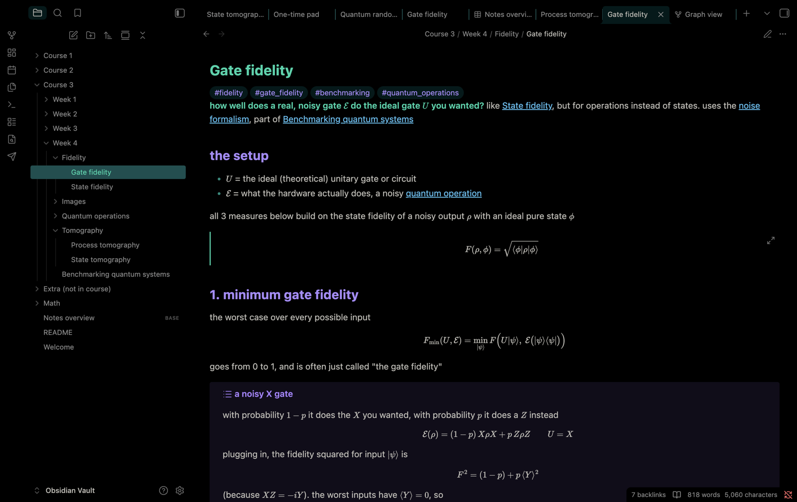

# Void Teal

A pure black Obsidian theme with teal, purple and blue accents. It's the Obsidian version of the [Void Teal VS Code theme](https://marketplace.visualstudio.com/items?itemName=Arham-dev.void-teal), so code blocks use the same syntax colors as the editor.

## Modes
- **Dark: Void Teal.** Pure black background with teal, purple and blue.
- **Light: Void Reef.** Warm off-white background with the same palette, darkened for contrast.

## Colors
| | Dark | Light |
|---|---|---|
| Accent / H1 / bold | `#00d4aa` | `#00a387` |
| H2 / tags / italic | `#a78bfa` | `#9c27b0` |
| Links / H3 / strings | `#4fc3f7` | `#0288d1` |
| Keywords | `#7c4dff` | `#7c4dff` |
| Functions | `#00bcd4` | `#00acc1` |
| Constants / errors | `#ff6b6b` | `#e53935` |
| Comments (italic) | `#00897b` | `#7a9e9a` |

## Install
**Settings → Appearance → Themes → Manage**, search for **Void Teal**, then click **Install and use**.

## License
MIT
